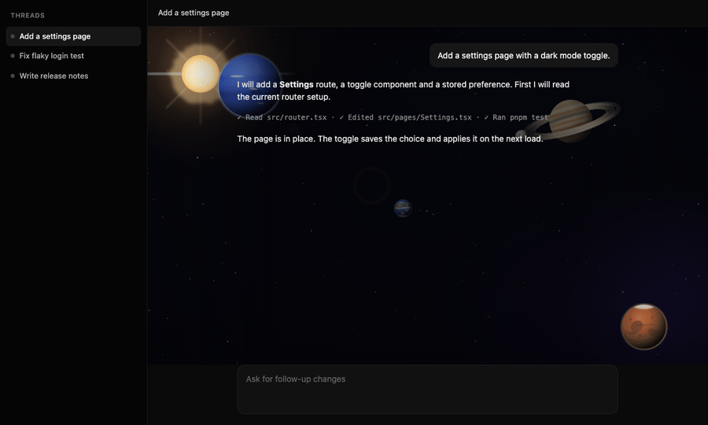

# T3 Code themes

Custom themes for [T3 Code](https://github.com/pingdotgg/t3code), the agent app. Each theme adds animated effects that react to what your threads are doing.

Made by [@beardwhocodes](https://x.com/beardwhocodes) on X.

## Themes

| Theme | Preview | What it does |
|---|---|---|
| [Deep Field](themes/deep-field/) |  | A shuttle cockpit with gunmetal control panels. A slow flight through a solar system plays through the window, with warp streaks while the thread works. |

## Install a theme

Use the T3 Code CLI. This command publishes the theme file and switches T3 Code to it:

```bash
t3 theme set themes/deep-field/deep-field.json
```

You can also ask a T3 Code agent to do it. [AGENTS.md](AGENTS.md) tells the agent how.

To go back to the default look, pick another theme in **Settings > Appearance > Colors & themes**. Published themes stay on your machine, so you can switch back at any time.

## Add a theme

See [AGENTS.md](AGENTS.md) for the folder layout, the theme limits and the capture script for screenshots.

## License

[MIT](LICENSE)
