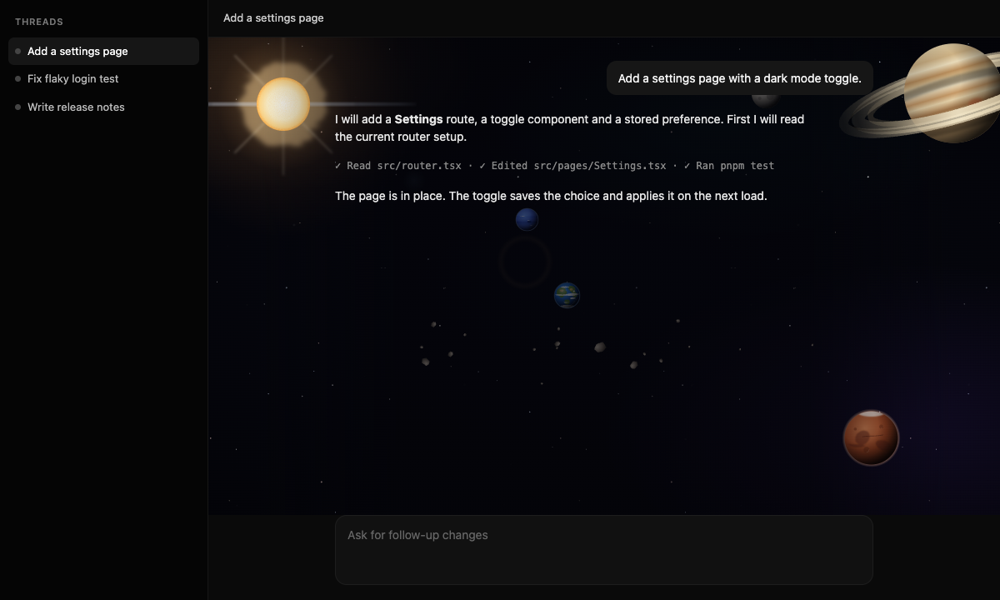
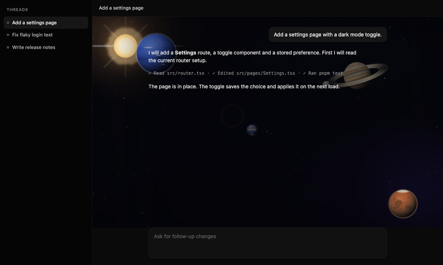
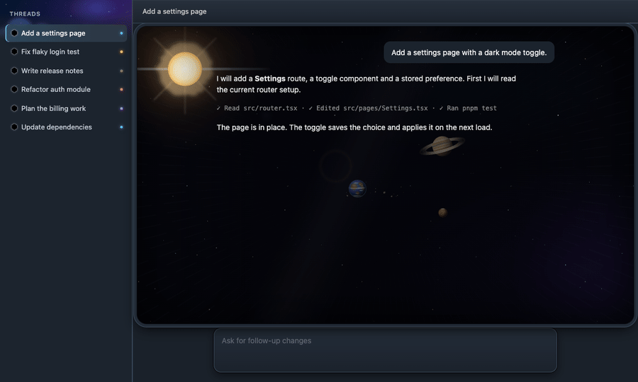

# Deep Field

A slow flight through a solar system, behind the open thread in T3 Code.



## What it shows

- A sun with a moving surface, a corona and lens flares, in the top-left corner.
- Planets that come toward you with true perspective: an earth, a blue ice planet, a red planet, and a ringed giant with an orbiting moon.
- An asteroid belt and two layers of stars.
- **Warp while the thread works.** When the open thread's status is Working, light streaks race out from the center and the stars move about 7 times faster. When the thread stops, the normal flight comes back.

| Normal flight (6x speed) | Warp while Working (2x speed) |
|---|---|
|  |  |


The previews come from a mock T3 Code page, made with [scripts/capture.sh](../../scripts/capture.sh). The GIFs are sped up. In the app, the flight is much slower.

## Install

```bash
t3 theme set themes/deep-field/deep-field.json
```

## Notes

- The space effects show only in **dark mode**. Light mode looks like the default T3 Code theme.
- The palette is the default T3 Code palette. Only the thread background changes.
- With `prefers-reduced-motion`, the animation stops.
- The warp effect reads the thread status from the sidebar. A T3 Code update can break it.
- The CSS is 19,914 of the 20,000 characters that T3 Code allows.

Made by [@beardwhocodes](https://x.com/beardwhocodes).
