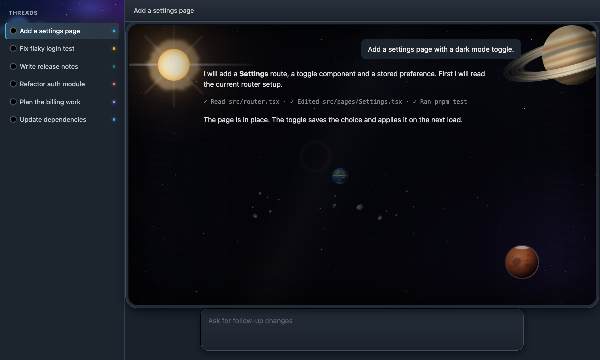

# Deep Field

You sit in a shuttle cockpit. The thread area is the window, and a slow flight through a solar system plays behind it. The sidebar, header and composer are gunmetal control panels.


## What it shows

**Through the window**
- A sun with a moving surface, a corona and lens flares, in the top-left corner.
- Planets that come toward you with true perspective: an earth, a red planet and a ringed giant.
- An asteroid belt and two layers of stars.
- **Warp while the thread works.** When the open thread's status is Working, light streaks race out from the center and the stars move about 7 times faster. When the thread stops, the normal flight comes back.

**The cockpit**
- A gunmetal sidebar, header and composer, with a thick frame around the window and a dark edge inside it.
- T3 Code's own Nightly artwork (sky, stars, sparkles and clouds) at the top of the sidebar.
- A status light on each thread row: blinking blue for Working, fast amber for Awaiting Input or Pending Approval, green for Completed, red for Failed, violet for Plan Ready.
- A blue edge on the open thread, and a thin light that moves along the bottom of the header.
- A soft light outline on project icons, so black icons stay visible.

| Normal flight (6x speed) | Warp while Working (2x speed) |
|---|---|
|  |  |



The previews come from a mock T3 Code page, made with [scripts/capture.sh](../../scripts/capture.sh). The GIFs are sped up. In the app, the flight is much slower.

## Install

```bash
t3 theme set themes/deep-field/deep-field.json
```

## Notes

- The cockpit and space effects show only in **dark mode**. Light mode looks like the default T3 Code theme.
- With `prefers-reduced-motion`, the animation stops.
- The status lights and the warp effect read the thread status from the sidebar row's label. A T3 Code update can break them.
- The window frame adds a small margin around the thread area.
- The CSS is 19,701 of the 20,000 characters that T3 Code allows.

Made by [@beardwhocodes](https://x.com/beardwhocodes).
